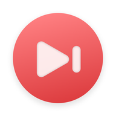

<p align="center">
  
</p>

<h1 align="center"><strong>Aura Player</strong></h1>

<p align="center">An open-source local and NetEase Cloud Music player for Android built with MIUIX and Backdrop.</p>

<p align="center">
  <a href="README.md">简体中文</a> |
  <strong>English</strong> |
  <a href="README_ja.md">日本語</a>
</p>

<p align="center">
  <a href="https://github.com/ColdP/AuraPlayer/releases">Releases</a> |
  <a href="https://t.me/HyperChanger">Telegram group</a> |
  <a href="https://qm.qq.com/q/rQhbQbiYLe">QQ group: 429188055</a>
</p>

<p align="center">
  
  
  
  
  
</p>

## Overview

Aura Player (`btm.m.auraplayer`) is an Android music player for Android 13 (API 33) and above. Built with MIUIX components, Backdrop glass materials, and Media3, it works both as a pure offline local player and as an optional NetEase Cloud Music client.

The source version is defined by `versionName` in [app/build.gradle.kts](app/build.gradle.kts); the README does not duplicate the version string. See [Releases](https://github.com/ColdP/AuraPlayer/releases) for downloads and release notes.

## Features

### Local Library and Home

- MediaStore local music scanning and permission handling with Songs, Local Playlists, Albums, Artists, Favorites, and Playback History.
- Retro Music-inspired home layout: greeting header, quick shortcuts, recently added, cover collage suggestions, and top/recent artists and albums.
- Folder blacklist/whitelist, minimum-duration filter, persistent sorting, pull-to-refresh, and categorized search.
- Adaptive responsive layout: compact track rows with `44dp` covers, multi-column grids on landscape/tablet screens, and preserved system font scaling.

### NetEase Cloud Music and Downloads

- **Official Direct Sign-In**: Signs in on the official HTTPS page (`music.163.com`) by default with no self-hosted backend or manual cookie copying required. Session cookies are encrypted via Android Keystore and cleared when logging out or switching service URLs.
- **Optional Custom API**: Advanced connection settings support connecting to a self-hosted [NeteaseCloudMusicApiEnhanced](https://github.com/NeteaseCloudMusicApiEnhanced/api-enhanced) server (including SMS verification login), with ready-to-run Node.js and Docker Compose files in `server/`.
- **Cloud Browsing and Details**: Cloud recommendations, paginated playlists (30 per page) and tracks (50 per page), search (All / Songs / Audio / Podcasts), album and artist detail pages, and audio quality selection.
- **Downloads and Tagging**: Downloads selected qualities via the Android system downloader; WorkManager decodes NCM containers in the background and writes FLAC/MP3 tags and artwork to `Music/Aura Player` (subject to NetEase account and regional rights).
- **Cache Management**: Artwork cache up to `128 MiB` and metadata cache up to `16 MiB`, with categorized inspection and clearing under Settings → NetEase Music → Cache.

### Now Playing, Lyrics, and Lyric Sharing

- **Media3 Playback and Gestures**: Background playback with media notifications, 0.5–3x playback speed, sleep timer, volume controls, drag-to-reorder queue, horizontal swipe track switching, mini-player to full-screen continuous morphing, swipe-down collapse, and predictive back.
- **Player Appearance**: Aurora, Blurred Aurora, Blur, Solid Color, and Full-Screen themes; snow and rain effects; multiple cover transitions (Card, Cover, Page Turn, Stack, Vertical/Horizontal Flip); keep-screen-on in lyrics mode; and auto-hiding immersive controls.
- **Multi-Source Lyrics**: Fetches from NetEase, QQ Music, Kuwo, Kugou, LrcLib, AMLL, and TTML Hub; supports word-by-word timing, translations, pronunciation, duet alignment, edge fade/blur shader, tap-to-seek, and 3-second browse focus auto-return.
- **Lyric Share Studio**: Multiple card templates (Aura Mesh, Cinema, Paper, Polaroid, Vinyl, Swiss, etc.) with customizable light/dark mode, fonts, backgrounds, filters, line spacing, corner radius, and image export/sharing.

### Audio Effects and Tag Editor

- **Built-In DSP Engine**: 15 built-in presets (Reference, Warmth, Clarity, Deep Bass, etc.) plus real-time custom tuning (multi-band EQ, preamp, automatic gain protection, stereo width, low-frequency crossfeed, harmonic coloration, and dynamics compressor), alongside fade-in/out and Always Play.
- **Preset Sharing**: Import, export, and share audio presets via Aura JSON files, JSON text, or ZXing QR codes.
- **Local Tag Editor**: Powered by `jaudiotagger` to edit title, artist, album, album artist, release date, year, track number, composer, lyricist, comment, and embedded artwork with system write confirmation.

### Visual Customization and Localization

- Built with MIUIX 0.9.4 and Backdrop: light, dark, and system themes, plus Monet color generation (Classic 2021 / Expressive 2025 specs, multiple palettes, and custom colors).
- Floating HyperOS, floating HarmonyOS, and Liquid Glass bottom navigation styles with customizable blur, opacity, refraction, highlight, and dispersion parameters.
- Built-in Simplified Chinese, English, and Japanese interfaces and localized legal documents (User Agreement, Disclaimer, Privacy Policy), extensible via [languages/example.json](languages/example.json).

## Compatibility and Requirements

| Item | Details |
| --- | --- |
| Minimum Android version | Android 13 (API 33) |
| Compile / target SDK | API 37 |
| Permissions | `READ_MEDIA_AUDIO` (local library and tag editing), `INTERNET` (streaming and lyrics), `MODIFY_AUDIO_SETTINGS` (audio effects), `POST_NOTIFICATIONS` and foreground media playback service (controls and download alerts) |

## Build from Source

Requirements: JDK 21 (matching CI; source/target compatibility Java 17+), Android SDK 37, and Android Studio or the Gradle Wrapper (9.6.1). Set `sdk.dir` in `local.properties`, then run:

```bash
git clone https://github.com/ColdP/AuraPlayer.git
cd AuraPlayer
./gradlew :app:assembleDebug
./gradlew :app:testDebugUnitTest
```

Windows PowerShell:

```powershell
.\gradlew.bat :app:assembleDebug
.\gradlew.bat :app:testDebugUnitTest
```

Debug APK output: `app/build/outputs/apk/debug/app-debug.apk`. See [.github/workflows/android.yml](.github/workflows/android.yml) for the CI workflow.

## Optional Self-Hosted NetEase API

If you prefer a custom API endpoint, use [NeteaseCloudMusicApiEnhanced](https://github.com/NeteaseCloudMusicApiEnhanced/api-enhanced). The [server/](server) directory pins dependencies and provides a startup script (Node.js 22+):

```powershell
cd server
npm ci
npm start
```

The default port is `3000` (configurable via `PORT`), or run `docker compose up -d` inside `server/`. Enter your LAN or HTTPS URL under Settings → NetEase Music → Advanced connection settings.

## Project Structure

```text
Aura-Player/
|-- app/
|   |-- src/main/java/       Kotlin / Java app, player, lyrics, DSP, and UI sources
|   |-- src/main/assets/     Language packs, trilingual legal docs, licenses, and NOTICE
|   |-- src/main/res/        Android resources and adaptive launcher icons
|   `-- src/test/java/       Local unit tests
|-- languages/example.json   Language-pack template
|-- server/                  Optional NeteaseCloudMusicApiEnhanced setup and Docker Compose
|-- tools/                   Localization helper script
|-- gradle/                  Gradle Wrapper
|-- README.md                Primary Chinese README
|-- README_en.md             English README
|-- README_ja.md             Japanese README
|-- CONTRIBUTING_zh.md       Chinese contributing guide
|-- CONTRIBUTING.md          English contributing guide
|-- CONTRIBUTING_ja.md       Japanese contributing guide
|-- NOTICE.md                Upstream sources and attribution
`-- LICENSE
```

## Contributing

Issues and pull requests are welcome. Read the [English contributing guide](CONTRIBUTING.md), [Chinese contributing guide](CONTRIBUTING_zh.md), or [Japanese contributing guide](CONTRIBUTING_ja.md) before contributing.

## License and Acknowledgments

This project is distributed under the [GNU AGPL-3.0-or-later](LICENSE) license. Ported components and third-party dependencies retain their respective licenses; see [NOTICE.md](NOTICE.md) for complete attribution and modification notes:

- UI styling, glass components, navigation motion, and About/Donate layouts from [HyperChanger](https://github.com/ColdP/HyperChanger) (AGPL-3.0-or-later).
- Home structure and MediaStore sorting adapted from [Retro Music](https://github.com/RetroMusicPlayer/RetroMusicPlayer) (GPL-3.0-or-later).
- UI widgets and glass rendering powered by [MIUIX 0.9.4](https://github.com/compose-miuix-ui/miuix) (Apache-2.0) and [Backdrop / Shapes](https://github.com/Kyant0/AndroidLiquidGlass) (Apache-2.0); playlist title-bar search uses [COUI-Kit](https://github.com/ItosEO/COUI-Kit) (MPL-2.0).
- Lyric fetching, matching, and rendering from [HyperMusicCover](https://github.com/zyl6932/HyperMusicCover) (AGPL-3.0), [HyperLyrics Enhanced](https://github.com/juren233/HyperLyrics-Enhanced) (GPL-3.0 / Apache-2.0), and [Accompanist Lyrics Core](https://github.com/6xingyv/Accompanist-Lyrics) (Apache-2.0).
- Additional dependencies: [Media3](https://developer.android.com/media/media3), [Coil](https://github.com/coil-kt/coil), [OkHttp](https://github.com/square/okhttp), [jaudiotagger](https://github.com/Adonai/jaudiotagger-android) (LGPL-2.1), [MaterialKolor](https://github.com/jordond/MaterialKolor) (MIT), [ZXing](https://github.com/zxing/zxing) (Apache-2.0), and [NeteaseCloudMusicApiEnhanced](https://github.com/NeteaseCloudMusicApiEnhanced/api-enhanced) (MIT).

## Star History

<a href="https://www.star-history.com/?repos=ColdP%2FAuraPlayer&type=date">
  <picture>
    <source media="(prefers-color-scheme: dark)" srcset="https://api.star-history.com/chart?repos=ColdP/AuraPlayer&type=date&theme=dark" />
    <source media="(prefers-color-scheme: light)" srcset="https://api.star-history.com/chart?repos=ColdP/AuraPlayer&type=date" />
    
  </picture>
</a>
