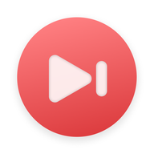

<p align="center">
  
</p>

<h1 align="center"><strong>Aura Player</strong></h1>

<p align="center">MIUIX と Backdrop で構築された、オープンソースのローカル＆NetEase Cloud Music プレイヤー。</p>

<p align="center">
  <a href="README.md">简体中文</a> |
  <a href="README_en.md">English</a> |
  <strong>日本語</strong>
</p>

<p align="center">
  <a href="https://github.com/ColdP/AuraPlayer/releases">リリース</a> |
  <a href="https://t.me/HyperChanger">Telegram グループ</a> |
  <a href="https://qm.qq.com/q/rQhbQbiYLe">QQ グループ：429188055</a>
</p>

<p align="center">
  
  
  
  
  
</p>

## 概要

Aura Player（パッケージ名 `btm.m.auraplayer`）は、Android 13（API 33）以上向けの音楽プレイヤーです。MIUIX の UI コンポーネント、Backdrop のガラスマテリアル、Media3 オーディオエンジンを組み合わせ、完全オフラインのローカル再生と任意の NetEase Cloud Music オンライン機能の両方に対応しています。

ソースコードのバージョンは [app/build.gradle.kts](app/build.gradle.kts) の `versionName` を基準とし、README ではバージョン文字列を重複管理しません。ダウンロードとリリースノートは [Releases](https://github.com/ColdP/AuraPlayer/releases) を参照してください。

## 機能

### ローカルライブラリとホーム

- MediaStore によるローカル音楽スキャンと権限管理、曲・ローカルプレイリスト・アルバム・アーティスト別の閲覧、お気に入り・再生履歴に対応しています。
- Retro Music 構成のホーム画面：挨拶ヘッダー、クイックショートカット、最近追加した曲、カバーコラージュのおすすめ、人気・最近のアーティストとアルバムを表示します。
- フォルダーのブラックリスト／ホワイトリスト、最短再生時間フィルター、並べ替え設定の保存、引っ張って更新、分類検索に対応しています。
- レスポンシブレイアウト：コンパクトな曲行と `44dp` カバーアートを採用し、横画面や大画面では列数を増やしつつシステムの文字サイズ倍率を維持します。

### NetEase Cloud Music とダウンロード

- **公式ダイレクトログイン**：既定では公式 HTTPS ページ（`music.163.com`）で直接ログインするため、独自サーバーの構築や Cookie の手動コピーは不要です。セッション Cookie は Android Keystore で暗号化保存され、ログアウトやサービス URL 変更時に自動削除されます。
- **任意の自前 API**：高度な接続設定から独自の [NeteaseCloudMusicApiEnhanced](https://github.com/NeteaseCloudMusicApiEnhanced/api-enhanced) サーバー（SMS 認証コードログイン含む）に接続できます。`server/` に Node.js および Docker Compose の起動設定を用意しています。
- **クラウド閲覧と詳細**：クラウドのおすすめ、ページング対応プレイリスト（1 ページ 30 件）と曲一覧（1 ページ 50 曲）、検索（すべて・曲・音声・ポッドキャスト）、アルバム・アーティスト詳細、音質切り替えに対応しています。
- **ダウンロードとタグ書き込み**：選択した音質をシステムダウンローダーで取得し、WorkManager がバックグラウンドで NCM デコードおよび FLAC / MP3 タグ・カバー埋め込みを行い、`Music/Aura Player` へ保存します（利用可能な音質はアカウント権限に依存します）。
- **キャッシュ管理**：カバー画像キャッシュ上限 `128 MiB`、メタデータキャッシュ上限 `16 MiB`。「設定 → NetEase Music → キャッシュ」から種別ごとに確認・削除できます。

### 再生画面、歌詞、歌詞共有

- **Media3 再生とジェスチャー**：バックグラウンド再生とメディア通知、0.5–3 倍速再生、スリープタイマー、音量操作、ドラッグ並び替え可能な再生キュー、左右スワイプ曲送り、ミニプレイヤーから全画面への連続展開、下スワイプ折りたたみ、予測型「戻る」に対応しています。
- **画面テーマ**：オーロラ、ぼかしオーロラ、ぼかし、単色、全画面テーマ、雪・雨エフェクト、曲切り替え時のカバーアニメーション（カード、カバー、ページめくり、スタック、縦／横回転）、歌詞表示中の画面オン維持、操作ボタンの自動非表示に対応しています。
- **マルチソース歌詞**：NetEase、QQ Music、Kuwo、Kugou、LrcLib、AMLL、TTML Hub から歌詞を取得し、字単位同期、翻訳、発音、デュエット配置、端のぼかしフェードシェーダー、タップシーク、3 秒後の自動フォーカス復帰に対応しています。
- **歌詞共有スタジオ**：多彩なカードテンプレート（Aura Mesh、Cinema、Paper、Polaroid、Vinyl、Swiss など）を備え、ライト／ダーク切替、フォント、背景、フィルター、行間、角丸を調整して画像保存・共有できます。

### 音響効果とタグエディター

- **内蔵 DSP エンジン**：15 種類の内蔵プリセット（原音忠実、ぬくもり、透明感、深い低音など）とリアルタイムのカスタム調整（マルチバンド EQ、プリアンプ、自動ゲイン保護、ステレオ幅、低域クロスフィード、倍音の色付け、ダイナミクスコンプレッサー）を搭載し、フェードイン／アウトや「常に再生」にも対応しています。
- **プリセット共有**：Aura JSON ファイル、JSON テキスト、ZXing QR コードによるプリセットのインポート・エクスポート・共有が可能です。
- **ローカルタグエディター**：`jaudiotagger` により曲名、アーティスト、アルバム、アルバムアーティスト、発売日、年、トラック番号、作曲者、作詞者、コメント、埋め込みカバーアートを編集できます（システムの書き込み承認後に保存）。

### 外観カスタマイズと多言語

- MIUIX 0.9.4 と Backdrop を採用し、ライト・ダーク・システム連動テーマ、Monet 動的配色（2021 / 2025 仕様、各種パレット、カスタムカラー）に対応しています。
- HyperOS フローティング、HarmonyOS フローティング、液体ガラスの下部ナビゲーションを選択でき、ぼかし、不透明度、屈折、ハイライト、色分散などを調整できます。
- 簡体字中国語、English、日本語の UI と三言語の法的文書（利用規約、免責事項、プライバシーポリシー）を内蔵し、[languages/example.json](languages/example.json) を用いて翻訳を拡張できます。

## 互換性と動作要件

| 項目 | 詳細 |
| --- | --- |
| 最小 Android バージョン | Android 13（API 33） |
| コンパイル / ターゲット SDK | API 37 |
| 主な権限 | `READ_MEDIA_AUDIO`（ローカルライブラリとタグ編集）、`INTERNET`（オンライン再生と歌詞）、`MODIFY_AUDIO_SETTINGS`（音響効果）、`POST_NOTIFICATIONS` およびフォアグラウンドメディア再生サービス（再生操作とダウンロード通知） |

## ソースコードからのビルド

必要な環境：JDK 21（CI と同じ；ソース互換 Java 17+）、Android SDK 37、Android Studio またはプロジェクトの Gradle Wrapper（9.6.1）。`local.properties` に `sdk.dir` を設定して以下を実行します：

```bash
git clone https://github.com/ColdP/AuraPlayer.git
cd AuraPlayer
./gradlew :app:assembleDebug
./gradlew :app:testDebugUnitTest
```

Windows PowerShell：

```powershell
.\gradlew.bat :app:assembleDebug
.\gradlew.bat :app:testDebugUnitTest
```

Debug APK の出力先：`app/build/outputs/apk/debug/app-debug.apk`。CI の手順は [.github/workflows/android.yml](.github/workflows/android.yml) を参照してください。

## 任意の自前 NetEase API

独自の API エンドポイントを使用する場合は [NeteaseCloudMusicApiEnhanced](https://github.com/NeteaseCloudMusicApiEnhanced/api-enhanced) を利用できます。リポジトリの [server/](server) ディレクトリに依存関係と起動設定（Node.js 22+）を含めています：

```powershell
cd server
npm ci
npm start
```

既定のポートは `3000`（環境変数 `PORT` で変更可）、または `server/` で `docker compose up -d` を実行します。起動後、アプリの「設定 → NetEase Music → 高度な接続設定」でローカル IP または HTTPS URL を入力してください。

## ディレクトリ構成

```text
Aura-Player/
|-- app/
|   |-- src/main/java/       Kotlin / Java のアプリ、再生、歌詞、DSP、UI ソース
|   |-- src/main/assets/     言語パック、三言語の法的文書、ライセンス、NOTICE
|   |-- src/main/res/        Android リソースとアダプティブアイコン
|   `-- src/test/java/       ローカル単体テスト
|-- languages/example.json   言語パックテンプレート
|-- server/                  任意の NeteaseCloudMusicApiEnhanced 起動・Docker 設定
|-- tools/                   ローカライズ補助スクリプト
|-- gradle/                  Gradle Wrapper
|-- README.md                中国語メイン README
|-- README_en.md             英語 README
|-- README_ja.md             日本語 README
|-- CONTRIBUTING_zh.md       中国語コントリビュートガイド
|-- CONTRIBUTING.md          英語コントリビュートガイド
|-- CONTRIBUTING_ja.md       日本語コントリビュートガイド
|-- NOTICE.md                上流ソースと帰属表記
`-- LICENSE
```

## 貢献

Issue や Pull Request を歓迎します。参加前に [日本語コントリビュートガイド](CONTRIBUTING_ja.md)、[English contributing guide](CONTRIBUTING.md)、または [中国語コントリビュートガイド](CONTRIBUTING_zh.md) をお読みください。

## ライセンスと謝辞

本プロジェクトは [GNU AGPL-3.0-or-later](LICENSE) ライセンスの下で公開されています。一部移植モジュールおよび外部ライブラリには各自のライセンスが適用されます。詳細は [NOTICE.md](NOTICE.md) をご覧ください：

- UI スタイル、ガラスコンポーネント、ナビゲーションアニメーション、アプリ情報／寄付画面レイアウト：[HyperChanger](https://github.com/ColdP/HyperChanger)（AGPL-3.0-or-later）。
- ホーム構成と MediaStore ソート処理の参考・移植：[Retro Music](https://github.com/RetroMusicPlayer/RetroMusicPlayer)（GPL-3.0-or-later）。
- UI コンポーネントとガラス描画：[MIUIX 0.9.4](https://github.com/compose-miuix-ui/miuix)（Apache-2.0）および [Backdrop / Shapes](https://github.com/Kyant0/AndroidLiquidGlass)（Apache-2.0）。
- 歌詞の取得・照合・描画：[HyperMusicCover](https://github.com/zyl6932/HyperMusicCover)（AGPL-3.0）、[HyperLyrics Enhanced](https://github.com/juren233/HyperLyrics-Enhanced)（GPL-3.0 / Apache-2.0）、[Accompanist Lyrics Core](https://github.com/6xingyv/Accompanist-Lyrics)（Apache-2.0）。
- その他の主な依存ライブラリ：[Media3](https://developer.android.com/media/media3)、[Coil](https://github.com/coil-kt/coil)、[OkHttp](https://github.com/square/okhttp)、[jaudiotagger](https://github.com/Adonai/jaudiotagger-android)（LGPL-2.1）、[MaterialKolor](https://github.com/jordond/MaterialKolor)（MIT）、[ZXing](https://github.com/zxing/zxing)（Apache-2.0）、[NeteaseCloudMusicApiEnhanced](https://github.com/NeteaseCloudMusicApiEnhanced/api-enhanced)（MIT）。

## Star History

<a href="https://www.star-history.com/?repos=ColdP%2FAuraPlayer&type=date">
  <picture>
    <source media="(prefers-color-scheme: dark)" srcset="https://api.star-history.com/chart?repos=ColdP/AuraPlayer&type=date&theme=dark" />
    <source media="(prefers-color-scheme: light)" srcset="https://api.star-history.com/chart?repos=ColdP/AuraPlayer&type=date" />
    
  </picture>
</a>
